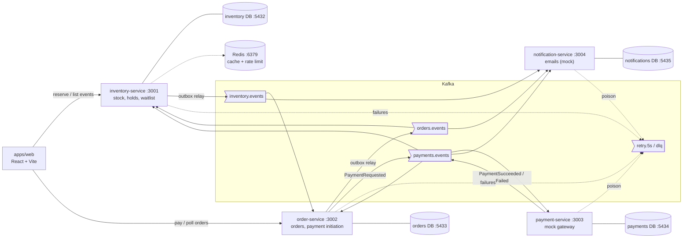
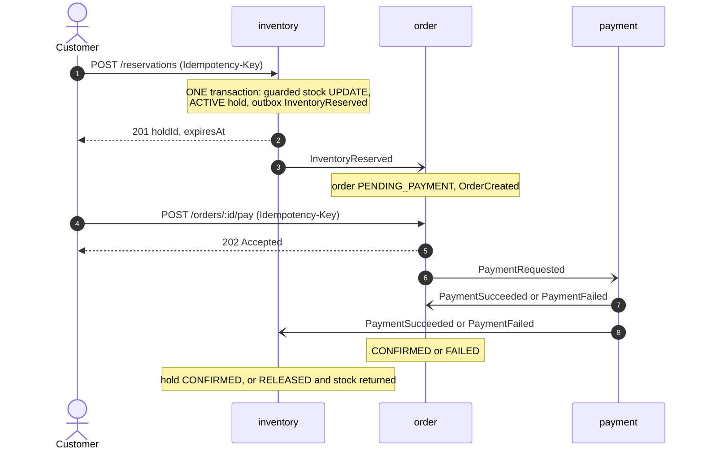
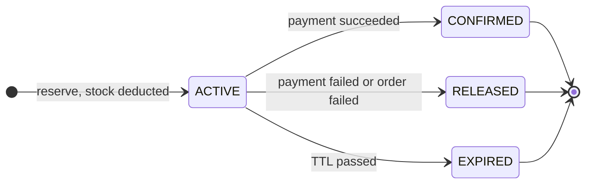
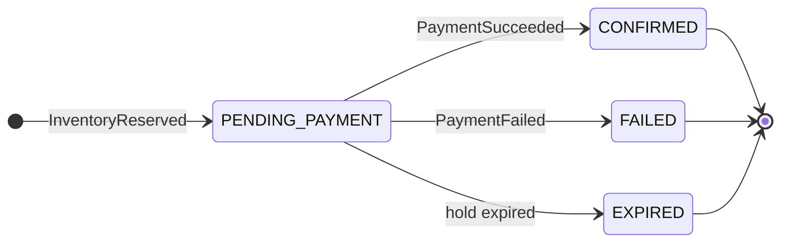

# SeatLock

A flash-sale ticketing platform built as event-driven microservices. Thousands of buyers hit a tiny
inventory at the same instant; the one rule is **never sell a ticket twice**.

- **Atomic reservations:** one guarded SQL `UPDATE` is the only place stock changes. Reservations are
  time-limited _holds_ that expire and return stock automatically.
- **Four services, no direct calls:** inventory, order, payment and notification coordinate only
  through Kafka, each with its own Postgres database.
- **Reliable events:** transactional outbox (no lost or phantom events), idempotent consumers
  (duplicates are harmless), retry topic and dead-letter queue with a replay CLI.
- **Provable:** integration tests on real Postgres, a k6 stampede test, and a chaos script that kills a
  service mid-purchase.

> **Status:** all seven milestones are implemented (shared package, four services, React UI, scripts,
> docs). Unit tests pass. Integration, k6, and chaos runs need Docker Desktop with a working WSL2
> distro — see [docs/load-test.md](docs/load-test.md) and [docs/chaos-test.md](docs/chaos-test.md).

## Contents

- [Architecture](#architecture)
- [Stack](#stack)
- [Prerequisites](#prerequisites)
- [Quick start](#quick-start)
- [Admin dashboard](#admin-dashboard)
- [Services and ports](#services-and-ports)
- [API overview](#api-overview)
- [Event catalog summary](#event-catalog-summary)
- [State machines](#state-machines)
- [Testing](#testing)
- [Operations: DLQ, load test, chaos](#operations-dlq-load-test-chaos)
- [Configuration](#configuration)
- [Repository layout](#repository-layout)
- [Documentation](#documentation)
- [Troubleshooting](#troubleshooting)

## Architecture



The purchase is a **choreographed saga**:



Full diagrams (service boundaries, failure branches, outbox, retry/DLQ flow) are in
[docs/architecture.md](docs/architecture.md).

## Stack

| Layer          | Technology                                                           |
| -------------- | -------------------------------------------------------------------- |
| Language       | TypeScript (ESM), Node.js 20+                                        |
| Services       | Fastify 5, Zod (validation and shared event schemas), pino (logging) |
| Messaging      | Apache Kafka 3.8 (KRaft, single broker) via kafkajs, Kafka UI        |
| Data           | PostgreSQL 16 (one database per service), `pg`                       |
| Cache / limits | Redis 7 via ioredis                                                  |
| Frontend       | React 18 + Vite + React Router (in progress)                         |
| Tests          | Vitest, Testcontainers (real Postgres), k6 (load)                    |
| Tooling        | npm workspaces, tsx, ESLint, Prettier, Docker Compose                |

## Prerequisites

- **Node.js 20+** (`.nvmrc` pins 20)
- **Docker** with Docker Compose v2 (Postgres x4, Kafka, Redis, Kafka UI)
- **k6** (optional, only for `npm run load-test`): https://grafana.com/docs/k6/latest/set-up/install-k6/
- Free ports: 3001-3004 (services), 5173 (web), 5432-5435 (Postgres), 6379 (Redis), 8080 (Kafka UI), 9092 (Kafka)

## Quick start

One command (bash / zsh):

```bash
docker compose up -d && npm install && cp .env.example .env && npm run migrate && npm run seed && npm run setup:topics && npm run dev
```

PowerShell (Windows): replace `cp` with `Copy-Item`, and use `;` or run the steps one at a time:

```powershell
docker compose up -d; npm install; Copy-Item .env.example .env; npm run migrate; npm run seed; npm run setup:topics; npm run dev
```

What each step does:

| Step                   | Purpose                                                                          |
| ---------------------- | -------------------------------------------------------------------------------- |
| `docker compose up -d` | Starts 4 Postgres, Kafka (KRaft), Redis, Kafka UI                                |
| `npm install`          | Installs all workspaces                                                          |
| `cp .env.example .env` | Local configuration (`.env` is git-ignored; see [Configuration](#configuration)) |
| `npm run migrate`      | Creates every service's schema (idempotent)                                      |
| `npm run seed`         | Inserts 3 events with fixed ids (see below)                                      |
| `npm run setup:topics` | Creates the 7 Kafka topics with explicit partition counts (idempotent)           |
| `npm run dev`          | Builds `@seatlock/shared`, then runs all four services and the web app           |

> **Timing:** the databases and Kafka take a few seconds to become healthy. If `migrate` or
> `setup:topics` reports a connection error right after `docker compose up -d`, wait and re-run, or use
> `docker compose up -d --wait` (blocks until healthchecks pass; Kafka needs about 20-30 s).
> `setup:topics` itself waits up to 60 s for the broker.

API only (no web app): `npm run dev:services`. Stop infrastructure with `npm run infra:down`
(keeps data). To also delete the data volumes and start from scratch: `docker compose down -v`.

### Seeded events

| Event                            | Id                                     | Tickets | Price   |
| -------------------------------- | -------------------------------------- | ------- | ------- |
| Neon Horizon World Tour          | `00000000-0000-4000-8000-00000000a001` | 500     | $125.00 |
| Midnight Echoes - Load Test Show | `00000000-0000-4000-8000-00000000a002` | 100     | $80.00  |
| Acoustic Sundown Sessions        | `00000000-0000-4000-8000-00000000a003` | 40      | $45.00  |

Restore full stock and wipe inventory's transactional state with
`npm run seed -w @seatlock/inventory-service -- --reset`.

### Try it

```bash
EVENT=00000000-0000-4000-8000-00000000a003
USER_ID=$(uuidgen)

# 1. reserve 2 tickets (Idempotency-Key is required)
curl -s -X POST http://localhost:3001/reservations \
  -H 'Content-Type: application/json' -H "Idempotency-Key: demo-$(date +%s)" \
  -d "{\"eventId\":\"$EVENT\",\"userId\":\"$USER_ID\",\"quantity\":2}"

# 2. a second later the order exists (created asynchronously via Kafka)
curl -s "http://localhost:3002/orders?userId=$USER_ID"

# 3. pay it (replace ORDER_ID); the result arrives asynchronously
curl -s -X POST "http://localhost:3002/orders/ORDER_ID/pay" \
  -H 'Content-Type: application/json' -H 'Idempotency-Key: demo-pay-1' -d '{}'
```

PowerShell users: use `Invoke-RestMethod` (examples in [docs/chaos-test.md](docs/chaos-test.md)) or
`curl.exe` with escaped quotes.

## Admin dashboard

The web app ships an operations dashboard at `/admin` (inventory, holds, orders, revenue and notification charts, auto-refreshing every 15s) and a create-event form at `/admin/events/new`, which calls `POST /events` on inventory-service. Run `npm run seed:demo` to populate demo holds, orders and notifications so the charts have data. These admin endpoints are unauthenticated and for demo use only.

## Services and ports

| Service              | Port | Database (port)      | Responsibility                                                |
| -------------------- | ---- | -------------------- | ------------------------------------------------------------- |
| inventory-service    | 3001 | inventory (5432)     | Events and stock, reservations (holds), hold expiry, waitlist |
| order-service        | 3002 | orders (5433)        | Orders, payment initiation, order state machine               |
| payment-service      | 3003 | payments (5434)      | Mock payment gateway (latency + failure rate)                 |
| notification-service | 3004 | notifications (5435) | Records and "sends" notifications (mock email)                |
| web (apps/web)       | 5173 | n/a                  | React UI                                                      |
| Kafka UI             | 8080 | n/a                  | Browse topics and consumer groups                             |

Every service exposes `GET /health/live` (process is up) and `GET /health/ready` (dependencies
reachable; `503` otherwise).

## API overview

All errors share one shape: `{ "error": { "code": "...", "message": "...", "details"?: ... } }`.
Send `X-Correlation-Id` to tag a flow; the id is echoed and propagated into events and logs.

### inventory-service (`:3001`)

| Method | Path            | Description                                                                                                                                                                                           |
| ------ | --------------- | ----------------------------------------------------------------------------------------------------------------------------------------------------------------------------------------------------- |
| GET    | `/events`       | List events with live `available` (cached 5 s; header `X-Cache: HIT/MISS`)                                                                                                                            |
| GET    | `/events/:id`   | One event (cached 5 s)                                                                                                                                                                                |
| POST   | `/reservations` | Body `{ eventId, userId, quantity }`, header `Idempotency-Key` (required). `201` hold, `404` unknown event, `409 SOLD_OUT`, `409 IDEMPOTENCY_CONFLICT`, `429 RATE_LIMITED` (per IP), `400` validation |
| GET    | `/holds/:id`    | Hold state with `secondsRemaining` (never cached): `holdId, status, expiresAt, orderId`                                                                                                               |
| POST   | `/waitlist`     | Body `{ eventId, userId, quantity }`, `Idempotency-Key`. Only allowed when the quantity is sold out (`409 TICKETS_AVAILABLE` otherwise; `409 ALREADY_WAITLISTED`)                                     |

Reservation response (`201`): `{ holdId, eventId, userId, quantity, status: "ACTIVE", expiresAt, unitPriceCents, totalPriceCents }`.
Replays carry `Idempotent-Replayed: true`. Limits: 1 to `MAX_TICKETS_PER_RESERVATION` (10) tickets.

### order-service (`:3002`)

| Method | Path              | Description                                                                                                                                                                                                                                                               |
| ------ | ----------------- | ------------------------------------------------------------------------------------------------------------------------------------------------------------------------------------------------------------------------------------------------------------------------- |
| GET    | `/orders/:id`     | One order                                                                                                                                                                                                                                                                 |
| GET    | `/orders`         | Query `userId` (required), `limit` (1-100, default 50), `offset`. Returns `{ items, limit, offset }`                                                                                                                                                                      |
| POST   | `/orders/:id/pay` | Header `Idempotency-Key` (required), body `{ currency? }`. `202 { orderId, paymentId, status, paymentStatus: "REQUESTED", amountCents, currency }`; `409 ORDER_NOT_PAYABLE`, `409 PAYMENT_ALREADY_INITIATED`. The payment outcome is asynchronous: poll `GET /orders/:id` |

### payment-service (`:3003`)

| Method | Path                     | Description                                                                              |
| ------ | ------------------------ | ---------------------------------------------------------------------------------------- |
| GET    | `/payments/:id`          | One payment                                                                              |
| GET    | `/payments`              | Query `orderId?`, `limit` (1-200)                                                        |
| POST   | `/payments/:id/simulate` | Debug only (disabled in production): `{ outcome: "succeed" \| "fail", reason?, force? }` |

### notification-service (`:3004`)

| Method | Path                 | Description                                |
| ------ | -------------------- | ------------------------------------------ |
| GET    | `/notifications`     | Query `userId` (required), `limit` (1-200) |
| GET    | `/notifications/:id` | One notification                           |

## Event catalog summary

Every Kafka message is an envelope `{ eventId, type, version, occurredAt, correlationId, producer, payload }`.
Full payloads, consumers and header conventions: **[docs/event-catalog.md](docs/event-catalog.md)**.

| Event                   | Topic                  | Producer   | Consumers                         |
| ----------------------- | ---------------------- | ---------- | --------------------------------- |
| `InventoryReserved`     | `inventory.events`     | inventory  | order, notification               |
| `InventoryReleased`     | `inventory.events`     | inventory  | order (reason `EXPIRED` only)     |
| `InventoryConfirmed`    | `inventory.events`     | inventory  | none yet                          |
| `HoldExpired`           | `inventory.events`     | inventory  | order                             |
| `WaitlistOffered`       | `inventory.events`     | inventory  | notification                      |
| `OrderCreated`          | `orders.events`        | order      | notification (records hold owner) |
| `OrderConfirmed`        | `orders.events`        | order      | inventory, notification           |
| `OrderFailed`           | `orders.events`        | order      | inventory, notification           |
| `OrderExpired`          | `orders.events`        | order      | inventory                         |
| `PaymentRequested`      | `payments.events`      | order      | payment                           |
| `PaymentSucceeded`      | `payments.events`      | payment    | order, inventory, notification    |
| `PaymentFailed`         | `payments.events`      | payment    | order, inventory, notification    |
| `NotificationRequested` | `notifications.events` | (none yet) | (none yet)                        |

Topics: `inventory.events`, `orders.events`, `payments.events`, `notifications.events`, `retry.5s`,
`retry.30s`, `dlq` (created by `npm run setup:topics`).

## State machines

Defined once in `packages/shared/src/state` and enforced by every writer. Terminal states have no
outgoing transitions.

**Hold** (inventory-service):



**Order** (order-service):



Waitlist entries (inventory-service): `WAITING -> OFFERED -> FULFILLED | CANCELLED`. Payments
(payment-service): `PENDING -> SUCCEEDED | FAILED`.

Inventory invariant per event: `available + SUM(ACTIVE holds) + SUM(CONFIRMED holds) = total_tickets`.

## Testing

```bash
npm test                    # every workspace's tests
npm run test:unit           # fast, no Docker (inventory: excludes *.integration.test.ts)
npm run test:integration    # needs Docker: Testcontainers starts real Postgres (and Kafka where used)
npm run lint
npm run format:check
```

What the integration tests assert (selected): 300 concurrent single-ticket requests for 100 tickets
produce exactly 100 successes; concurrent retries with one `Idempotency-Key` create one hold;
concurrent releases restore stock exactly once; confirm-vs-expire has exactly one winner; one order per
hold even for different message ids; a duplicated `PaymentSucceeded` is applied once.

## Operations: DLQ, load test, chaos

| Task                 | Command                                                        | Docs                                     |
| -------------------- | -------------------------------------------------------------- | ---------------------------------------- |
| Create Kafka topics  | `npm run setup:topics` (`-- --list` to inspect)                | [scripts/README.md](scripts/README.md)   |
| Inspect dead letters | `npm run dlq:inspect`                                          | header of `scripts/dlq-replay.ts`        |
| Replay dead letters  | `npm run dlq:replay -- --dry-run --all`, then `-- --all --yes` | same                                     |
| Load test (k6)       | `npm run load-test` (see prerequisites first)                  | [docs/load-test.md](docs/load-test.md)   |
| Chaos test           | `npm run chaos -- --dry-run`, then `npm run chaos`             | [docs/chaos-test.md](docs/chaos-test.md) |

**Load test prerequisite you must not skip:** inventory-service rate-limits each client IP (default 20
requests per 60 s) and k6 sends everything from one IP. Start inventory-service with
`RATE_LIMIT_MAX=1000000` for the run, reseed with `--reset`, and flush Redis. Details in
[docs/load-test.md](docs/load-test.md). The documented result there is **"Not yet executed — run
`npm run load-test` after infra is up."** until you run it.

## Configuration

`.env.example` documents every variable; copy it to `.env`.

> **Important:** only **order-service** loads `.env` by itself. inventory, payment and notification
> services read the _process environment_ and otherwise use built-in defaults (which match
> `.env.example`). To change a setting for one of those (for example `HOLD_TTL_SECONDS` or
> `RATE_LIMIT_MAX`), export it in the shell that starts the service:
>
> ```powershell
> $env:HOLD_TTL_SECONDS = '30'; npm run dev:services
> ```
>
> ```bash
> HOLD_TTL_SECONDS=30 npm run dev:services
> ```

Useful knobs:

| Variable                                       | Service   | Default  | Effect                               |
| ---------------------------------------------- | --------- | -------- | ------------------------------------ |
| `HOLD_TTL_SECONDS`                             | inventory | 300      | How long a reservation is held       |
| `RATE_LIMIT_MAX` / `RATE_LIMIT_WINDOW_SECONDS` | inventory | 20 / 60  | Per-IP limit on `POST /reservations` |
| `CACHE_TTL_SECONDS`                            | inventory | 5        | Read cache TTL                       |
| `MAX_TICKETS_PER_RESERVATION`                  | inventory | 10       | Per-request ticket cap               |
| `CONSUMER_MAX_ATTEMPTS`                        | inventory | 3        | Attempts before dead-lettering       |
| `MAX_RETRY_ATTEMPTS` / `RETRY_DELAY_MS`        | order     | 5 / 5000 | Retry policy                         |
| `PAYMENT_FAILURE_RATE`                         | payment   | 0.2      | Probability a mock payment fails     |
| `PAYMENT_LATENCY_MS`                           | payment   | 500      | Simulated gateway latency            |

## Repository layout

```text
seatlock/
  apps/web/                  React + Vite UI (in progress)
  packages/shared/           event types, Zod schemas, topics, state machines, errors
  services/
    inventory-service/       :3001  stock, holds, waitlist, expiry sweeper, outbox relay
    order-service/           :3002  orders, payment initiation, outbox relay, retry + DLQ
    payment-service/         :3003  mock gateway, outbox relay
    notification-service/    :3004  mock notifications
  scripts/                   setup-topics, dlq-replay, chaos-test (+ README)
  tests/load/                k6 reservation stampede
  docs/                      architecture, event catalog, ADRs, trade-offs, load/chaos docs, interview prep
  docker-compose.yml         4x Postgres, Kafka (KRaft), Redis, Kafka UI
```

## Documentation

| Document                                                                       | What it covers                                                  |
| ------------------------------------------------------------------------------ | --------------------------------------------------------------- |
| [docs/architecture.md](docs/architecture.md)                                   | Diagrams: boundaries, saga, failure branches, outbox, retry/DLQ |
| [docs/event-catalog.md](docs/event-catalog.md)                                 | Every event: producer, consumers, payload                       |
| [docs/adr/001-transactional-outbox.md](docs/adr/001-transactional-outbox.md)   | Why and how events are published reliably                       |
| [docs/adr/002-inventory-concurrency.md](docs/adr/002-inventory-concurrency.md) | Why stock can never be oversold                                 |
| [docs/adr/003-saga-choreography.md](docs/adr/003-saga-choreography.md)         | Why a choreographed saga                                        |
| [docs/tradeoffs.md](docs/tradeoffs.md)                                         | Trade-offs and known gaps                                       |
| [docs/load-test.md](docs/load-test.md)                                         | k6 procedure and results template (not yet executed)            |
| [docs/chaos-test.md](docs/chaos-test.md)                                       | Manual chaos procedures                                         |
| [docs/interview-prep.md](docs/interview-prep.md)                               | Talking points for a Product Engineer interview                 |
| [scripts/README.md](scripts/README.md)                                         | Script usage and notes                                          |

## Troubleshooting

| Symptom                                                   | Cause and fix                                                                                                   |
| --------------------------------------------------------- | --------------------------------------------------------------------------------------------------------------- |
| `Cannot find module '@seatlock/shared'` or missing `dist` | The shared package must be built: `npm run build:shared` (`npm run dev` does it for you)                        |
| `migrate` / `setup:topics` cannot connect                 | Containers are still starting. Wait for `docker compose ps` to show `healthy`, or `docker compose up -d --wait` |
| `429 RATE_LIMITED` when reserving                         | Per-IP limit (20 per 60 s). Wait a minute, or export `RATE_LIMIT_MAX` for inventory-service; see load-test docs |
| Stock number on the page lags a few seconds               | Read cache (5 s). Expected; the authoritative check is the reservation itself                                   |
| Changing `.env` has no effect                             | Restart the service after editing `.env` (all four services load repo-root `.env` on boot)                      |
| An order does not appear after reserving                  | order-service down or lagging: check `GET :3002/health/ready`, consumer lag in Kafka UI, `npm run dlq:inspect`  |
| Port already in use                                       | Another process holds 3001-3004 / 5432-5435 / 6379 / 8080 / 9092; stop it or change the port mapping            |
| `Docker Desktop is unable to start`                       | Needs a working WSL2 distro. Install Ubuntu, run `wsl --update`, **reboot Windows**, then open Docker Desktop  |
| Integration / k6 / chaos cannot run                       | Same as above — Postgres and Kafka come from `docker compose`. Unit tests do not need Docker                   |
