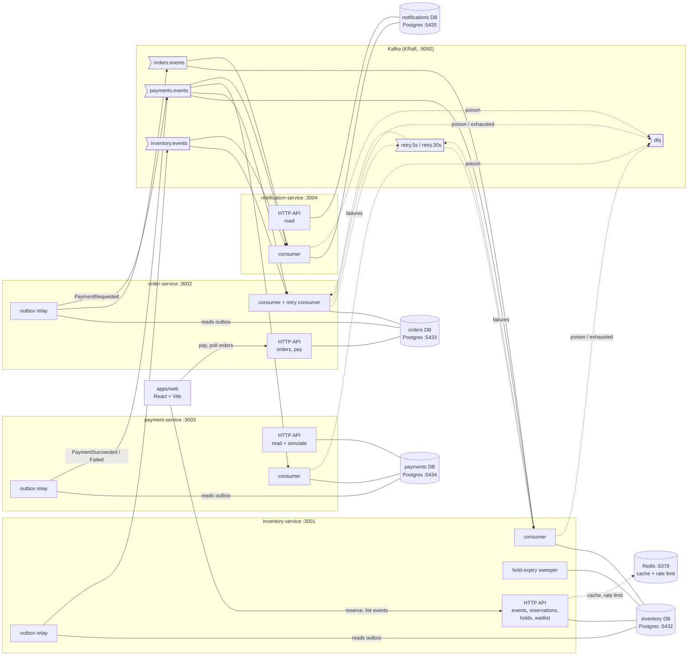
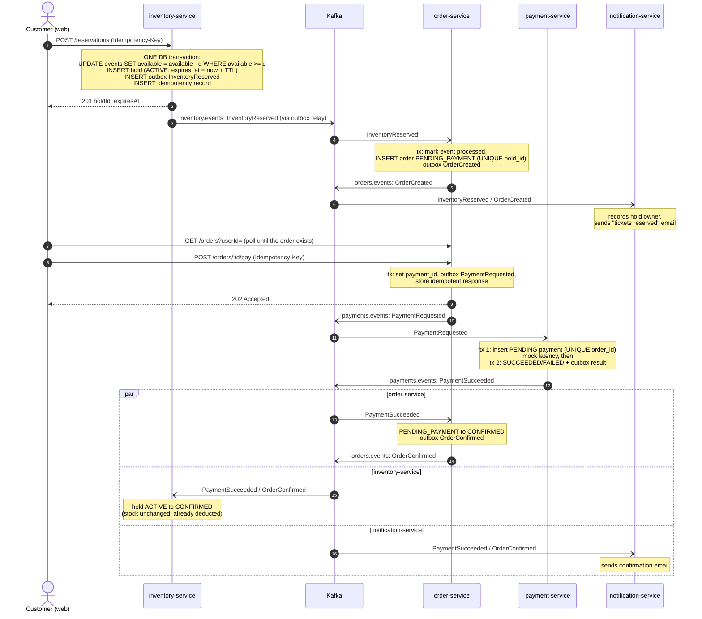
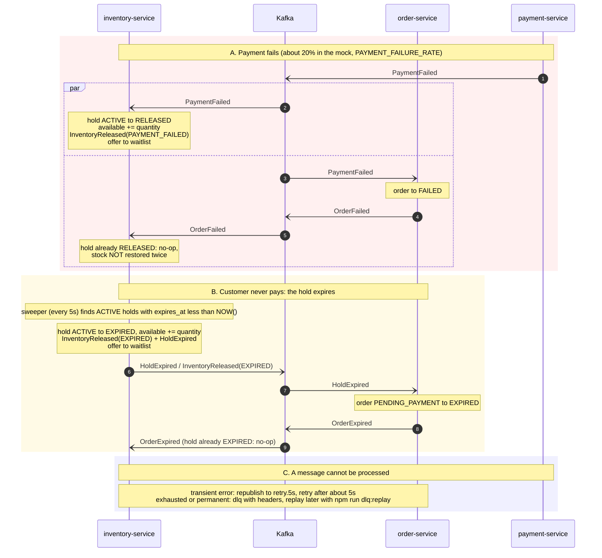
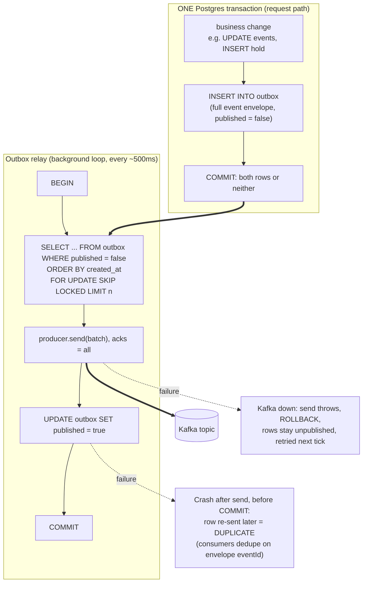
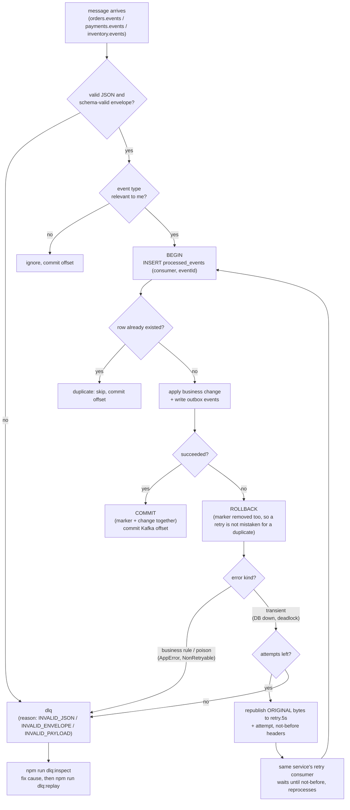
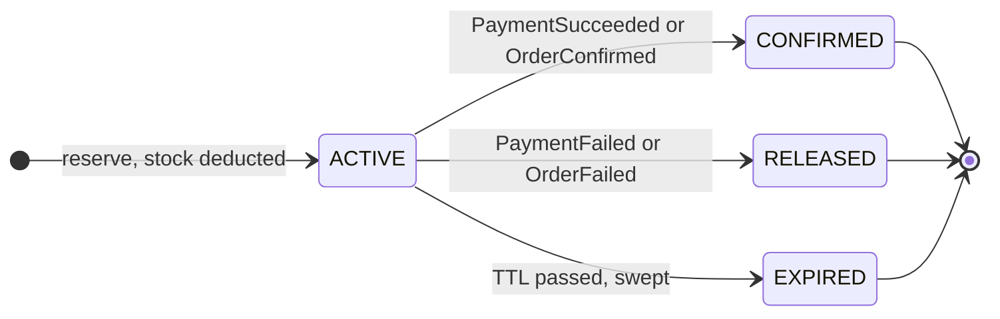
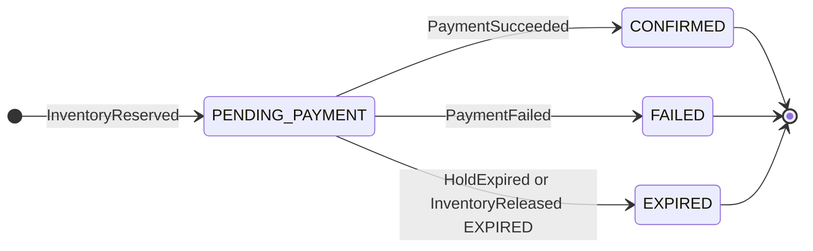

# Architecture

SeatLock is a flash-sale ticketing platform built as four small services that never call each other
over HTTP. They cooperate only through Kafka events, and each service owns its own database.

- [1. Service boundaries](#1-service-boundaries)
- [2. The reservation saga (happy path)](#2-the-reservation-saga-happy-path)
- [3. Saga failure branches](#3-saga-failure-branches)
- [4. The transactional outbox](#4-the-transactional-outbox)
- [5. Consumer side: idempotency, retry and DLQ](#5-consumer-side-idempotency-retry-and-dlq)
- [6. Data ownership](#6-data-ownership)
- [7. Topics and partitioning](#7-topics-and-partitioning)
- [8. Read path: caching and rate limiting](#8-read-path-caching-and-rate-limiting)
- [9. State machines](#9-state-machines)
- [10. Failure matrix](#10-failure-matrix)

Related: [event catalog](event-catalog.md) · [ADR-001 outbox](adr/001-transactional-outbox.md) ·
[ADR-002 inventory concurrency](adr/002-inventory-concurrency.md) ·
[ADR-003 saga choreography](adr/003-saga-choreography.md) · [trade-offs](tradeoffs.md)

---

## 1. Service boundaries

Boundary rules:

1. **No synchronous service-to-service calls.** The web app is the only HTTP client of the services. A
   service being down never makes another service's API fail.
2. **One database per service.** No shared tables, no cross-database joins. Data needed elsewhere is
   carried in events (for example `InventoryReserved` includes `userId`, `quantity`,
   `unitPriceCents`, so order-service never queries inventory).
3. **Events are the contract.** Every payload has a Zod schema in `packages/shared`, validated when
   written to the outbox and again when consumed. See the [event catalog](event-catalog.md).
4. **Redis is optional.** Cache and rate limiter fail open; correctness lives in Postgres.

| Service              | Port | Owns                                 | Produces                                                 | Consumes                                               |
| -------------------- | ---- | ------------------------------------ | -------------------------------------------------------- | ------------------------------------------------------ |
| inventory-service    | 3001 | events (stock), holds, waitlist      | `inventory.events`                                       | `orders.events`, `payments.events`, `retry.5s`         |
| order-service        | 3002 | orders, payment initiation           | `orders.events`, `payments.events` (`PaymentRequested`)  | `inventory.events`, `payments.events`, `retry.5s`      |
| payment-service      | 3003 | payments (mock gateway)              | `payments.events` (`PaymentSucceeded` / `PaymentFailed`) | `payments.events`                                      |
| notification-service | 3004 | notifications log, hold-owner lookup | nothing                                                  | `inventory.events`, `orders.events`, `payments.events` |

---

## 2. The reservation saga (happy path)

A **choreographed** saga ([ADR-003](adr/003-saga-choreography.md)): nobody orchestrates; each service
reacts to events and emits new ones.

Key idea: **stock is deducted at reservation time**, not at payment time. The hold is a lease on
already-deducted stock, so a confirmation never competes with other buyers.

---

## 3. Saga failure branches

Three things can stop the happy path, and each has a compensating action that returns stock exactly
once.

Race handling, which is the interesting part:

| Race                                           | Why it resolves safely                                                                                                                                                                           |
| ---------------------------------------------- | ------------------------------------------------------------------------------------------------------------------------------------------------------------------------------------------------ |
| Hold expiry vs. payment success                | Both use `UPDATE holds ... WHERE id = $1 AND status = 'ACTIVE'` under a row lock. Exactly one wins.                                                                                              |
| `PaymentFailed` and `OrderFailed` both release | First release flips the hold; the second finds it not `ACTIVE` and does nothing (stock is restored once).                                                                                        |
| Duplicate Kafka delivery                       | `processed_events (consumer_name, event_id)` primary key, inserted in the same transaction as the business change.                                                                               |
| Payment succeeds after the hold expired        | Order is `EXPIRED` (terminal): order-service logs "refund required" and ignores; inventory dead-letters the confirm. **No automatic refund exists** (known gap, see [trade-offs](tradeoffs.md)). |
| Two orders for one hold                        | `orders.hold_id UNIQUE` with `ON CONFLICT DO NOTHING`.                                                                                                                                           |
| Client retries a reservation / payment         | `Idempotency-Key` stored with the response in the same transaction; same key + same body replays.                                                                                                |

---

## 4. The transactional outbox

The problem: a service cannot atomically "update Postgres **and** publish to Kafka". There is no
transaction spanning both. Commit-then-crash loses the event; publish-then-rollback announces something
that never happened. See [ADR-001](adr/001-transactional-outbox.md).

Properties:

- **Atomicity:** the event exists if and only if the business change committed.
- **Delivery:** at-least-once. Duplicates are possible after a crash between "send" and "mark
  published", so **every consumer must be idempotent** (they are; see section 5).
- **Ordering:** inventory events are keyed by concert id; order and payment events by order id. Kafka
  guarantees order per key within a partition. Several relay instances can run
  (`FOR UPDATE SKIP LOCKED`) but then cross-batch order is best-effort; order-service uses a single
  advisory lock so only one relay publishes at a time.
- **Cost:** extra table, extra write per event, and added latency of the polling interval
  (about 500 ms by default).
- Each of the three producing services (inventory, order, payment) has its own outbox table and relay.

---

## 5. Consumer side: idempotency, retry and DLQ

- **Why a retry topic instead of retrying in place?** In-place retry blocks the partition
  (head-of-line blocking): one stuck message stalls every order behind it. Parking it on `retry.5s`
  keeps the main consumer moving. Trade-off: a retried message can be processed after later messages
  for the same entity. That is safe here because every handler is idempotent and tolerant of order
  (state machines refuse illegal transitions).
- **Never lose a message:** if publishing to the retry topic or DLQ itself fails, the error propagates,
  the offset is not committed and Kafka redelivers.
- **Per-service differences (honest summary):**
  inventory-service and order-service implement the full retry-then-DLQ policy.
  payment-service and notification-service dead-letter malformed messages immediately and otherwise
  rely on kafkajs redelivery when the handler throws.
- `retry.30s` is provisioned by `npm run setup:topics` but no service uses it yet.

---

## 6. Data ownership

| Database (port)      | Tables                                                                          | Notes                                                                                        |
| -------------------- | ------------------------------------------------------------------------------- | -------------------------------------------------------------------------------------------- |
| inventory (5432)     | `events`, `holds`, `waitlist`, `idempotency_keys`, `outbox`, `processed_events` | `events.available CHECK (>= 0)`; partial indexes on active holds and unpublished outbox rows |
| orders (5433)        | `orders`, `idempotency_keys`, `outbox`, `processed_events`, `schema_migrations` | `orders.hold_id UNIQUE`                                                                      |
| payments (5434)      | payments, outbox, processed events                                              | `UNIQUE(order_id)`: one payment per order                                                    |
| notifications (5435) | notifications, hold owners, processed events                                    |                                                                                              |

Nothing reads another service's database. Information crosses boundaries only as events.

---

## 7. Topics and partitioning

Created by `npm run setup:topics`:

| Topic                  | Partitions | Key                | Purpose                                                         |
| ---------------------- | ---------- | ------------------ | --------------------------------------------------------------- |
| `inventory.events`     | 6          | concert (event) id | Reserved / Released / Confirmed / HoldExpired / WaitlistOffered |
| `orders.events`        | 6          | order id           | OrderCreated / Confirmed / Failed / Expired                     |
| `payments.events`      | 6          | order id           | PaymentRequested (command) and PaymentSucceeded / Failed        |
| `notifications.events` | 3          | n/a                | Reserved for future use; nothing produces or consumes it        |
| `retry.5s`             | 3          | original key       | Delay queue (about 5 s) shared by services                      |
| `retry.30s`            | 3          | n/a                | Provisioned, not used yet                                       |
| `dlq`                  | 1          | original key       | Dead letters; 14-day retention                                  |

Keying by concert id means all events for one concert are totally ordered; keying by order id keeps one
order's payment conversation ordered. Different concerts and orders spread across partitions.

---

## 8. Read path: caching and rate limiting

- `GET /events` and `GET /events/:id`: Redis read-through cache, **5 s TTL**, with an in-process
  stampede guard. Stale stock numbers are advisory; the authoritative check is the atomic `UPDATE`
  in `POST /reservations`, so a stale "3 left" at worst yields a clean `409 SOLD_OUT`.
- `GET /holds/:id` is never cached (clients poll it for the checkout countdown).
- `POST /reservations` is rate limited per client IP (fixed window in Redis, Lua script so `INCR` and
  `EXPIRE` are atomic). Defaults: 20 requests per 60 s. Response headers `X-RateLimit-*`; `429` with
  `Retry-After`. Behind a proxy, set `TRUST_PROXY=true` so the real client IP is used.
- If Redis is down, both features are skipped (fail open).

---

## 9. State machines

Hold (owned by inventory-service) and order (owned by order-service); defined once in
`packages/shared/src/state` and enforced by every writer. Terminal states have no outgoing edges.

Hold:

Order:

---

## 10. Failure matrix

| What fails                         | User-visible effect                                      | Data effect                            | Recovery                                            |
| ---------------------------------- | -------------------------------------------------------- | -------------------------------------- | --------------------------------------------------- |
| order-service down                 | Reservations work; orders appear late                    | `InventoryReserved` waits in Kafka     | Automatic on restart (consumer offset)              |
| payment-service down               | `POST /pay` still `202`; order stays `PENDING_PAYMENT`   | `PaymentRequested` waits in Kafka      | Automatic on restart, unless the hold expires first |
| notification-service down          | No emails                                                | Events wait in Kafka                   | Automatic on restart                                |
| inventory-service down             | Cannot reserve; orders/payments in flight still progress | Confirm/release events wait            | Automatic on restart                                |
| Kafka down                         | Reservations still succeed; downstream work pauses       | Events pile up in outbox tables        | Relays drain backlog when Kafka returns             |
| Redis down                         | Slower reads, no rate limiting                           | none                                   | Automatic                                           |
| inventory Postgres down            | Reservations fail with 500; `/health/ready` is `503`     | Consumers retry then dead-letter       | Restart DB, then `npm run dlq:replay`               |
| Poison message                     | none                                                     | Parked in `dlq`                        | Inspect; fix producer; do not replay garbage        |
| Payment succeeds after hold expiry | Customer charged without tickets (mock)                  | Order `EXPIRED`; confirm dead-lettered | **Manual refund; no automation yet**                |

Manual procedures for these are in [chaos-test.md](chaos-test.md).
